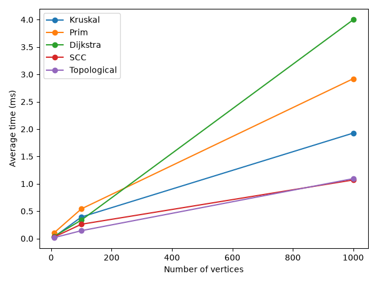

# Assignment 3 – Smart City Infrastructure and Route Planning

## Overview

This is a Java program that uses graphs for a city road network. Vertices represent districts and edges represent roads. Edge weights can mean construction cost or travel distance. I used adjacency lists to store the graphs.

## Implementation

The project uses Java 17. The code is in the folders from the assignment:

- `graph` - graph data and random graph generation
- `dsu` - find and union with path compression and union by rank
- `mst` - Kruskal and Prim
- `connectivity` - topological sorting and SCC
- `shortestpath` - Dijkstra

`Main` runs the program, `Tests` checks the answers, and `Benchmark` runs the experiments.

Kruskal sorts roads by weight and uses DSU to avoid cycles. Prim uses a priority queue to keep choosing the cheapest road to a new vertex. Topological sorting uses Kahn's algorithm and returns no order if there is a cycle. For SCC I used Kosaraju, which runs DFS twice. Dijkstra uses a priority queue and saves previous vertices to show the shortest path, not just the distance.

## Complexity Analysis

V is the number of vertices and E is the number of edges. The graphs use adjacency lists, and the priority queues use binary heaps.

| Algorithm | Time | Extra space |
|---|---|---|
| DSU find/union | O(α(V)) amortized per operation | O(V) for the DSU arrays |
| Kruskal | O(E log E + E α(V)) | O(V + E) |
| Prim | O(E log E) | O(V + E) |
| Topological sort | O(V + E) | O(V) |
| Kosaraju SCC | O(V + E) | O(V + E) |
| Dijkstra | O((V + E) log E) | O(V + E) |

DSU path compression shortens the parent paths. Union by rank keeps the trees from becoming too deep. This is why find and union are very fast after many operations.

Kruskal has to sort all edges, so having more edges affects its time. Prim and Dijkstra use priority queues and also process edges. Topological sorting and SCC visit vertices and edges, so their time is O(V + E). Dijkstra does not work reliably with negative weights because it assumes the shortest distance already chosen will not later decrease.

## Experimental Setup

I used these graph sizes:

| Size | Vertices | Edges |
|---|---:|---:|
| Small | 10 | 30 |
| Medium | 100 | 500 |
| Large | 1000 | 5000 |

Every experiment is repeated 5 times. I used `System.nanoTime` and took the average time. The program also counts operations such as edge checks, DSU calls and priority queue work. The counts are different types of work for different algorithms, so they should mainly be compared within the same algorithm.

The random seeds are fixed so the graphs can be generated again. For MST, the generator first connects all vertices with a spanning tree, then adds more roads. DAG edges go from lower to higher vertex numbers, so there are no cycles. The cyclic test adds opposite-direction edges. The SCC graphs use random directed edges, which can have cycles. The generated weights are positive.

## Results

These are the average times in milliseconds from the included experiment. The complete numbers and operation counts are in `benchmarks.csv`. Times may be different on another computer.

| Algorithm | 10 vertices | 100 vertices | 1000 vertices |
|---|---:|---:|---:|
| Kruskal | 0.052 | 0.551 | 1.947 |
| Prim | 0.181 | 0.630 | 3.169 |
| Dijkstra | 0.040 | 0.370 | 4.515 |
| Topological (DAG) | 0.028 | 0.219 | 1.488 |
| Topological (cycle) | 0.006 | 0.142 | 0.169 |
| SCC | 0.066 | 0.276 | 1.291 |

MST results:

| Vertices | Kruskal weight | Prim weight | Kruskal operations | Prim operations |
|---|---:|---:|---:|---:|
| 10 | 222 | 222 | 158 | 644 |
| 100 | 1222 | 1222 | 5204 | 19373 |
| 1000 | 11993 | 11993 | 68079 | 261802 |

Execution time compared with vertices:

Execution time compared with edges:

## Comparison and Discussion

Kruskal was faster than Prim in these runs, but both found the same MST weight. Prim had more counted operations. Their counts are not exactly the same type of operation, so the time comparison is more useful than comparing the raw counts directly.

Dijkstra took longer on bigger graphs because it checked more roads. SCC also got slower as V and E increased, which is what O(V + E) suggests. Topological sorting found an order for the DAGs and detected cycles in the cyclic graphs. Some cycle tests were faster because they did not process a full order.

The results mostly match the complexity analysis. The exact times are not perfectly consistent because Java warm-up and other programs can affect very short measurements. That is also why each test was run five times.

## Testing

`Tests` checks connected and disconnected graphs, a single vertex, duplicate weights and multiple possible MSTs. It also checks that Kruskal and Prim get the same MST weight.

For directed graphs it checks a valid topological order, cycle detection and that every vertex belongs to exactly one SCC. For Dijkstra it checks shortest distances and paths, unreachable vertices, and rejecting negative weights.

The tests run when `Main` starts.

## Conclusion

Kruskal and Prim can be used to plan the cheapest road network connecting all districts. Topological sorting can order tasks or connections when there is no cycle. SCC finds groups of locations that can reach each other. Dijkstra finds the shortest routes when all weights are non-negative.

## How to Run

Open the folder in IntelliJ IDEA using JDK 17. Run `Main`. This runs the tests and writes the benchmark CSV.